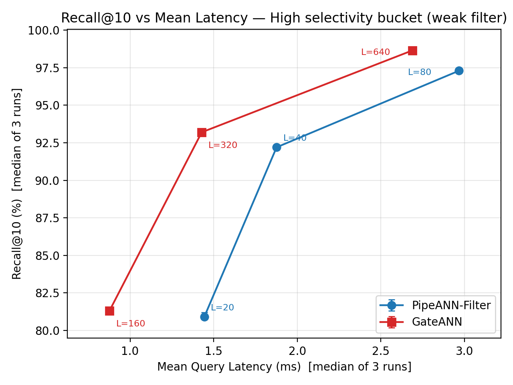
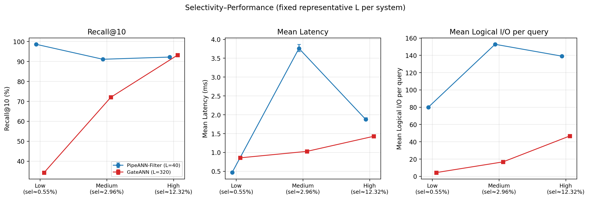
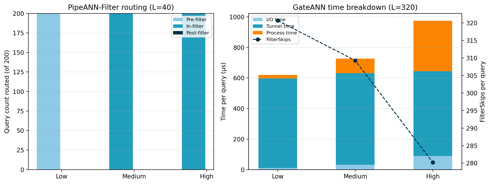
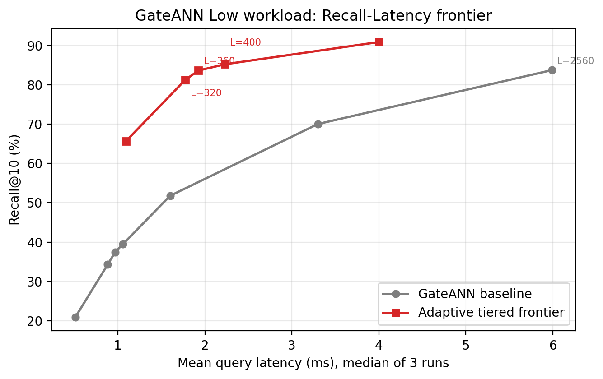

# 基于 SSD 的过滤向量检索系统性能测试与设计比较

> 计算机系统设计课程实验报告，个人独立完成
> 正式实验 experiment-id：`20260923-182732`

## 1. 实验环境与复现信息

实验环境与复现信息如表 1-1 所示。

表 1-1　实验环境与复现信息

| 项目 | 内容 |
|---|---|
| CPU | Intel Xeon Platinum 8481C，容器 cgroup 配额 16 vCPU；宿主 2×48 核 / 192 逻辑核 |
| 内存 | 容器限额 80 GiB，cgroup `memory.max` ≈ 85.9 GB；宿主机 1 TiB |
| SSD 型号与文件系统 | Intel SSDPF2KX076T9N NVMe SSD ×2 组成 RAID1 卷 `/dev/md0`，XFS 文件系统，实验数据盘配额 50 GB |
| 操作系统与内核 | Ubuntu 20.04.5 LTS Focal Fossa，Linux 5.15.0-94-generic |
| 编译器 | g++ (Ubuntu 9.4.0-1ubuntu1~20.04.1) 9.4.0，CMake 3.26.0，Python 3.8.10 |
| PipeANN-Filter Commit | `2ec84fe20c37dc3cc236b66f7eba31c0cc80bf1e` |
| GateANN Commit | `71e87cbf0e25c0400c0109dd25a64a7c4dccc9dd` |
| I/O Backend | AIO |
| 公共参数 | threads=1，beamwidth=8，K=10，mem_L=0，缓存预算=0，GateANN FullAdj=32 |
| 正式实验 experiment-id | `20260923-182732`，独立重复 3 轮，两套系统共 30 行结果 |

两套系统均成功完成 Debug 构建与查询验证，其中 PipeANN-Filter 构建耗时 13.1 s，GateANN 构建耗时 11.9 s；所有查询正常退出，正确性检查通过。构建期曾出现一处链接未完成问题，删除残缺可执行文件后重新链接即可解决，不涉及源码改动。

基础复现实验未修改课程脚本逻辑，也未修改两套系统算法源码；仅将数据与索引下载配置中的 URL 默认值调整为可访问的下载通道，该改动不影响数据或索引内容，GateANN 的编译兼容补丁由课程脚本自动应用。课程统一参数全部保持原样。第 5 节的优化实验另建 GateANN 工作树，在同一固定 Commit 上应用独立补丁，并始终以关闭优化策略的同一二进制作为对照组；补丁、脚本和汇总结果保存在 `optimization/filter_frontier/`，不会混入第 4 节的基础实验数据。

## 2. 系统设计理解

### 2.1 PipeANN-Filter

PipeANN-Filter 是基础系统 PipeANN 的过滤检索扩展，沿用其 SSD 常驻图索引布局：SSD 上每个节点记录包含全精度向量、常规出边以及追加的 2-hop 稠密邻居，稠密邻居用于低选择率时维持连通性，属性也可与向量共置于同一记录；标签另以倒排索引存放在 SSD。DRAM 中常驻 PQ 压缩向量、PQ pivots、节点 tags 与代价估计所需的统计摘要，属性侧还为每个向量维护小型布隆过滤器，用于快速的近似成员判断。过滤条件的判定被抽象为精确与近似两个接口，近似接口给出有效点的超集且没有假阴性。论文的核心思想是**推测式过滤**，原文称为 speculative filtering：搜索不再要求"探索的每个点都有效"，而是借助布隆过滤器与倒排在内存完成成员判断、只探索有效点的超集，从而避免为读取属性而引入随机 SSD I/O。假阳性在取得 top-k 候选后利用与向量共置的属性做最终精确校验，校验 I/O 可与重排 I/O 合并；少量假阳性还充当"桥"节点，改善过滤子图的连通性。因此一次过滤查询的主流程为：按代价选择执行路径 → 沿该路径得到候选并校验过滤谓词 → 精确重排返回 top-k。

对于每个查询，系统在三种机制中选择预估代价最小者。Pre-filter 扫描倒排索引生成候选集，再做 PQ 暴力近邻；In-filter 在搜索中过滤，并按选择率与近似精度调整有效搜索预算；Post-filter 则先检索再过滤。代价模型把预估 I/O 与计算量加权求和，选择性与近似精度由统计摘要估算。In-filter 每步扫描直接邻居与 2-hop 稠密邻居，并优先探索"可能有效"的节点。该设计预期消除属性读取开销，在弱过滤下用 In-filter 保持高召回，在极强过滤下用 Pre-filter 精确枚举、不产生假阳性；其代价是假阳性探索与重排开销、2-hop 邻居带来的索引空间放大，以及中段选择率附近的搜索预算膨胀可能引起延迟上升。

### 2.2 GateANN

GateANN 直接在**未修改的** Vamana 图索引上工作：SSD 保存图拓扑与全精度向量，DRAM 常驻 PQ 压缩向量。此外还有两个只读元数据结构常驻内存：**过滤存储**保存每个节点的标签集，按节点 ID 即可完成谓词判定；**完整邻接表**保存每节点的前若干条邻居，在启动时由磁盘索引顺序扫描构建并预取常驻。一次过滤查询中，候选节点在**发起 SSD I/O 之前**先由过滤存储完成谓词判定，这一机制称为 Pre-I/O Filtering：通过者走正常路径，异步读取全精度向量、计算精确距离并扩展邻居；失败者不读盘，也不算精确距离，而是在内存邻接表上做"隧道"扩展，即论文中的 Graph Tunneling：取其邻居、以 PQ 近似距离排序并插入候选前沿。两条路径汇入同一排序前沿，最终结果只来自通过过滤的节点。

该设计把节点的"结果候选"与"路由中转"两种角色解耦：路由只需要邻居表与近似距离，不需要 SSD 上的全精度向量，因此被过滤掉的节点完全不产生 SSD I/O；单跳隧道可自然组合成多跳，穿越任意长的非匹配区域，在零读盘条件下保持过滤后子图的连通性，SSD 读次数随匹配密度降低而成比例减少，且支持任意谓词、无需重建索引。代价则是邻接表与过滤存储带来的内存开销、元数据的构建与预取成本、隧道扩展对近似距离排序的依赖，以及强过滤下搜索预算被跳过节点稀释，需要更大的搜索预算或邻接表度才能维持召回。

### 2.3 设计比较

两套系统在过滤查询机制、数据布局、预期优势与潜在代价上的对比见表 2-1。

表 2-1　两套系统的设计比较

| 系统 | 过滤查询机制 | DRAM 中的主要结构 | SSD 中的主要结构 | 预期优势 | 潜在代价 |
|---|---|---|---|---|---|
| PipeANN-Filter | 推测式过滤 + Pre/In/Post 动态路由 | PQ 向量、布隆过滤器、标签统计摘要 | 图 + 全精度向量 + 2-hop 稠密边；标签倒排索引 | 弱过滤高吞吐；强过滤精确保召回 | 索引空间放大；中段选择率预算膨胀 |
| GateANN | 读前过滤 + 图隧道 | PQ 向量、过滤存储、完整邻接表 | 标准 Vamana 图 + PQ | 无效 SSD I/O 极少；强过滤延迟低 | 邻接表内存开销；强过滤召回受限 |

两套系统的本质差异在于**过滤判断的位置**与**对图连通性的处理**：PipeANN-Filter 在"探索哪些点"上做文章，用带假阳性的超集探索换取避免属性 I/O，并依靠 2-hop 稠密边在低选择率下维持连通性；GateANN 把过滤判断完全前移到任何 I/O 之前，用内存邻接表穿越被过滤区域来保留连通性。前者将成本压在逐个节点的图探索上，中段选择率时预算膨胀；后者将成本压在内存中的隧道扩展上，强过滤时预算被跳过节点稀释。这也决定了两者在不同 Selectivity 下的相反表现，详见 §4.2。

## 3. 实验方法

实验使用 `YFCC Filtered Vector Search Course Dataset v1` 与统一谓词 `selected_label in point_labels`。Debug tier 含 10 万向量，仅用于构建与正确性验证；Formal tier 含 100 万向量，维度 192、uint8 类型，距离度量为 L2。查询按真实标签分为三档，每档 5 个标签、40 条查询，共 200 条。其中 Low 档的 Selectivity 为 0.250%–0.851%，中位数 0.545%，属于强过滤；Medium 档为 1.765%–4.995%，中位数 2.958%；High 档为 7.074%–17.089%，中位数 12.323%，属于弱过滤。

两套系统使用同一预构建的 1M 索引，未重新构建 Formal 索引，并在同一台机器与同一块 SSD 上测试；公共参数为 threads=1、beamwidth=8、K=10、mem_L=0、缓存预算=0。搜索预算方面，PipeANN-Filter 在 High 档取 L=20/40/80，在 Medium/Low 档取代表值 L=40；GateANN 在 High 档取 L=160/320/640，在 Medium/Low 档取代表值 L=320。正式实验独立重复 3 轮，共 30 行结果。

结果按 `system + bucket + L` 分组，对 Recall、延迟、QPS 与 I/O 取三轮中位数，并报告最小/最大值作为波动范围。Recall 直接使用系统输出的百分数，延迟使用 Query Phase 的 `mean_latency_us`，不把包含加载时间的 `elapsed_seconds` 当作查询延迟。

需要说明的是，两套系统内部 `L` 的含义与搜索行为并不相同，PipeANN-Filter 的 In-filter 会按选择率放大等效预算，GateANN 的 L 还会被隧道扩展占用。因此比较公平性时以"Recall 相近的运行点"对齐，而不是以相同的 L 数值对齐。

所有实验在同一容器实例中顺序执行，期间没有其它计算任务；正式实验三轮连续运行，页缓存处于热态；任务三的补充实验在正式实验之后进行，单点重复 2 轮，其数值波动已在分析中如实体现。

主要实验命令如下，均在仓库根目录执行：

```bash
bash scripts/download_dataset.sh && bash scripts/check_dataset.sh
bash scripts/prepare_pipeann.sh && bash scripts/prepare_gateann.sh
python3 adapters/pipeann_adapter.py build  --repo "$PWD/systems/PipeANN" \
  --dataset-root "$PWD/datasets/yfcc_course_v1" --tier debug --run-root "$PWD/course_runs" --threads 8
python3 adapters/gateann_adapter.py build --repo "$PWD/systems/GateANN-public" \
  --dataset-root "$PWD/datasets/yfcc_course_v1" --tier debug --run-root "$PWD/course_runs" --threads 8
bash scripts/run_debug_validation.sh
bash scripts/download_indexes.sh && bash scripts/check_indexes.sh
bash scripts/run_formal_experiments.sh          # 正式实验：3 轮，experiment-id 20260923-182732

# 任务三补充实验：PipeANN-Filter 三档 Selectivity 的 L 扫描，各 2 轮
python3 adapters/pipeann_adapter.py search --repo "$PWD/systems/PipeANN" \
  --dataset-root "$PWD/datasets/yfcc_course_v1" --tier formal --run-root "$PWD/course_runs" \
  --bucket medium --threads 1 --beamwidth 8 --k 10 --L 20 80 160 320 --run-id supp-medium-lsweep-r1
# low/high 档与第二轮同理；汇总与绘图见 course_runs/analysis/analyze_results.py 与 supp_lsweep.py
```

## 4. 实验结果与机制分析

### 4.1 High workload 的 Recall–Latency

在 High workload 上，两套系统的 Recall@10 与平均延迟随搜索预算的变化如图 4-1 所示，对应数值汇总于表 4-1。曲线按三轮实验的中位数绘制，误差线为三轮结果范围，各点标注搜索预算 L。



*图 4-1　High workload 上 Recall@10–Mean Latency 曲线*

表 4-1　High workload 上两套系统的性能结果

| 系统 | L | Recall@10 (%) | Mean Latency (µs) | QPS | Mean I/O (次/查询) |
|---|---:|---:|---:|---:|---:|
| PipeANN-Filter | 20 | 80.90 [80.9, 81.2] | 1443.7 [1440.7, 1493.9] | 688.4 | 98.60 |
| PipeANN-Filter | 40 | 92.20 [92.1, 92.3] | 1876.4 [1876.0, 1925.0] | 530.7 | 139.10 |
| PipeANN-Filter | 80 | 97.30 [97.2, 97.3] | 2967.6 [2963.4, 3030.2] | 334.5 | 226.60 |
| GateANN | 160 | 81.30 [81.3, 81.3] | 876.4 [874.1, 890.5] | 1141.0 | 24.67 |
| GateANN | 320 | 93.20 [93.2, 93.2] | 1428.6 [1422.5, 1434.7] | 700.0 | 46.74 |
| GateANN | 640 | 98.65 [98.65, 98.65] | 2688.2 [2673.8, 3021.1] | 372.0 | 88.92 |

从表 4-1 与图 4-1 可以看到，随着搜索预算 L 增加，两套系统的 Recall 均单调上升，延迟与逻辑 I/O 同步上升。PipeANN-Filter 从 L=20→80：Recall 80.9%→97.3%，提升 16.4 个百分点，延迟 1.44 ms→2.97 ms，I/O 98.6→226.6 次/查询；GateANN 从 L=160→640：Recall 81.3%→98.65%，提升 17.35 个百分点，延迟 0.88 ms→2.69 ms，I/O 24.7→88.9 次/查询。延长的探索直接转化为更多的候选读取与距离计算，因此 Recall 的每一步提升都以近似线性的延迟与 I/O 为代价。

从图 4-1 中 Recall 相近的运行点比较两套系统，可以看到差距随 Recall 上升而收窄。约 81% Recall 处，PipeANN-Filter L=20 对 GateANN L=160，GateANN 延迟 876 µs，为 PipeANN-Filter 1444 µs 的 **0.61×**，逻辑 I/O 24.7 对 98.6，约 1/4；在约 92–93% 处，L=40 对 L=320，延迟 1429 µs 对 1876 µs，为 0.76×，I/O 46.7 对 139.1，约 1/3；在约 98% 处，L=80 对 L=640，差距收窄为 2688 µs 对 2968 µs，为 0.91×，I/O 88.9 对 226.6，约 2/5。内部行为可以解释该差距：GateANN 的 FilterSkips 在 L=160/320/640 分别为 143.1/280.2/557.0 次/查询，被挡下的候选完全不产生 SSD 读，其时间分解以隧道为主，分别为 323/555/1065 µs，SSD I/O 时间仅 93/89/107 µs；而 PipeANN-Filter 逐个探索节点都需要读盘，High 档 L=20→80 时估计 I/O 51.2→206.4、实测 I/O 99.2→226.6，且假阳性 8.6/12.4/19.0 次/查询进一步消耗预算。

最后需要说明 I/O 指标的可比性边界。`mean_ios` 是各系统内部报告的逻辑 I/O。两套系统的 I/O 页面大小不同，PipeANN-Filter 日志为 `IO size = 8192`，GateANN 为 `Size per IO = 4096`，因此不能直接等同于块设备物理 I/O，也不能仅据此判定优劣；上文的倍数关系用于解释机制，而非绝对性能排名。此外，本实验在单台容器实例上完成，延迟/QPS 的绝对值只在本环境内可比，不应与其它机器或同学的绝对数值直接比较。

### 4.2 Selectivity–Performance

固定代表性 L 下，两套系统在 Low、Medium、High 三档的 Recall@10、平均延迟与平均逻辑 I/O 如图 4-2 所示，PipeANN-Filter 的过滤路由分布与 GateANN 的时间分解、FilterSkips 如图 4-3 所示，具体数值与关键内部指标见表 4-2。图中横轴标注各档 Selectivity 的中位数与实际范围，PipeANN-Filter 取 L=40，GateANN 取 L=320。



*图 4-2　三档 Selectivity 下两套系统的 Recall@10、Mean Latency 与 Mean I/O*

表 4-2　三档 Selectivity 下两套系统的性能与关键内部指标

| 系统 | Bucket | Selectivity 范围/中位数 | Recall@10 (%) | Mean Latency (µs) | QPS | Mean I/O (次/查询) | 关键内部指标，单位 次/查询或 µs |
|---|---|---|---|---|---:|---:|---|
| PipeANN-Filter | Low | 0.250%–0.851% / 0.545% | 98.60 [98.6, 98.6] | 471.8 [465.9, 498.1] | 2110.5 | 80.0 | 路由 200/0/0，全为 Pre-filter；FP=0 |
| PipeANN-Filter | Medium | 1.765%–4.995% / 2.958% | 91.10 [90.9, 91.3] | 3760.1 [3675.4, 3869.8] | 263.8 | 152.8 | 路由 0/200/0，全为 In-filter；FP=24.4 |
| PipeANN-Filter | High | 7.074%–17.089% / 12.323% | 92.20 [92.1, 92.3] | 1876.4 [1876.0, 1925.0] | 530.7 | 139.1 | 路由 0/200/0；FP=12.4 |
| GateANN | Low | 同上 | 34.30 [34.3, 34.3] | 856.9 [855.4, 870.3] | 1167.0 | 4.38 | FilterSkips=320.7； Tunnel=585、 Process=24、 IO=11 |
| GateANN | Medium | 同上 | 72.05 [72.05, 72.05] | 1028.8 [1017.3, 1061.6] | 972.0 | 16.75 | FilterSkips=309.3； Tunnel=600、 Process=95、 IO=31 |
| GateANN | High | 同上 | 93.20 [93.2, 93.2] | 1428.6 [1422.5, 1434.7] | 700.0 | 46.74 | FilterSkips=280.2； Tunnel=555、 Process=330、 IO=89 |

*表中为三轮中位数 [最小值, 最大值]；固定 L 实验用于观察工作负载敏感性，不是固定 Recall 质量下的性能排名。*



*图 4-3　PipeANN-Filter 的过滤路由分布与 GateANN 的时间分解、FilterSkips*

由图 4-2 与表 4-2 可见，两套系统对过滤强度的敏感性相反。过滤变强、即向 Low 档推进时，PipeANN-Filter 在 Low 档的 200 条查询全部切换为 Pre-filter，先用倒排索引枚举满足标签的候选，再在候选集内做 PQ 近邻，Recall 反而升至 98.6%，延迟降到 472 µs，假阳性为 0。这是因为强过滤下候选集很小，约 0.5%×1M ≈ 5 千个，枚举与暴力排序都很便宜。但 Medium 档全部走 In-filter 且延迟达到 **3760 µs，为整条曲线的最差点，比 High 慢 2 倍**，同时 Recall 低于 Low：该现象与 In-filter 的等效预算按 `L/s×R/R_d` 膨胀密切相关，s=2.96% 时约 4.2×L，另外还有 24.4 次/查询的假阳性，详见 §4.4。
GateANN 的表现相反，过滤变强时 I/O 大幅下降，从 46.7 降至 16.8 再到 4.4 次/查询；Pre-I/O 过滤按比例挡掉无效读，对应论文中"相对 post-filter 基线的 I/O 降低幅度 ≈1/s"的结构性规律。延迟小幅下降，但 **Recall 从 93.2% 跌到 34.3%**。内部指标显示 FilterSkips 达到 320.7 次/查询，≈L=320，即搜索预算绝大部分被"跳过+隧道"消耗；时间分解中隧道扩展 585 µs，占总延迟约 68%，而 SSD I/O 仅 11 µs。这说明强过滤下瓶颈已从 SSD 转移到内存中的邻居扩展与 PQ 计算，且固定预算 L 与固定隧道度 32 不足以在 0.5% 的匹配密度下找到足够的有效近邻；提高预算可部分恢复召回，见 §4.4 现象二的补充验证。

综合上述结果，PipeANN-Filter 在强过滤区"越过滤越快越准、中段最差"，GateANN 在强过滤区"I/O 最少但召回崩塌"。需要强调的边界是，由于三档使用不同的真实标签，标签频率、语义与向量分布会同时变化，桶间差异不能全部归因于 Selectivity 单一变量；上述结论基于本课程工作负载与固定参数。

### 4.3 资源 Trade-off

两套系统在索引大小、查询进程峰值内存与关键额外结构上的对比见表 4-3。

表 4-3　两套系统的资源与关键结构对比

| 系统 | 索引大小 (GiB) | 查询峰值 RSS (MiB) | 关键额外结构 | 获得的收益 |
|---|---:|---:|---|---|
| PipeANN-Filter | 8.425 | 162.4 [162.3, 162.7] | 2-hop 稠密边 R_d=256、SSD 标签倒排 776 MiB、内存布隆过滤器 4 B/点 | 弱过滤 In-filter 高召回；强过滤 Pre-filter 精确保召回 |
| GateANN | 0.475 | 424.6 [421.6, 426.6]，含 mmap 邻接表约 126 MiB | Filter store CSR 49 MB、FullAdj 邻接表 132 MB，MAP_POPULATE | 无效 SSD I/O 大幅减少，强过滤下 4.4 次/查询 |

PipeANN-Filter 的索引是 GateANN 的约 **17.8 倍**，即 8.425 GiB 对 0.475 GiB，主要由 2-hop 稠密边与 SSD 端标签倒排造成；但它的查询进程 RSS 只有 162 MiB，把绝大部分状态留在了 SSD 上。GateANN 则相反：索引极小，由未修改的 Vamana 图、PQ 与两个元数据文件构成，但查询进程需要把邻接表与过滤存储载入内存，RSS 约 424 MiB，其中 FullAdj 的 `MAP_POPULATE` 直接计入；它用约 260 MiB 的额外常驻内存，换来了弱过滤区约 1.6 倍的延迟优势与约 4 倍的逻辑 I/O 下降，以 DRAM 换 I/O。需要注意 `peak_rss_kb` 是查询子进程整个生命周期的峰值 RSS，系统间差值不能完全归因于某一个内部结构；任务中 `mem_L=0`、缓存预算=0，RSS 差异主要由 GateANN 的元数据结构与 mmap 策略贡献。

### 4.4 关键现象与瓶颈总结

第一个关键现象是 PipeANN-Filter 在中段选择率上出现延迟峰值。测量结果显示，固定 L=40 时，Medium 档 s≈2.96% 的延迟为 3760 µs，约为 High 档 s≈12.3% 的 2.0 倍，也是 Low 档 472 µs 的 8 倍；但 Medium 的 Recall 91.1% 并不高于另外两档的 98.6% 与 92.2%。Medium 的 EstCmp 为 8068.8，是 High 档 2316.4 的 3.5 倍，假阳性 24.4 次/查询约为 2 倍。从源码机制看，`src/search/spec_filter_search.cpp` 的代价模型用同一单位权重累计 Pre-filter 的批量 PQ 扫描与 In-filter 的图扩张比较，从而为全部 Medium 查询选择 In-filter。这一现象说明固定代价模型对不同执行路径的实际开销刻画仍不充分，但本实验最终选择第二个、机制更明确且能做等召回验证的 GateANN 瓶颈作为优化对象。

第二个关键现象是 GateANN 在强过滤下召回崩塌，瓶颈转入内存隧道。测量结果显示，Low 档固定 L=320 时 Recall@10 仅 34.3%，High 档为 93.2%；FilterSkips 320.7 次/查询几乎等于 L，逻辑 I/O 只剩 4.38 次/查询，隧道时间 585 µs 占查询延迟的约 2/3。从机制看，读前过滤使不匹配节点不产生任何 SSD 读，但强过滤下匹配邻居密度极低，仅 0.545%，搜索前沿主要在被跳过的节点间做隧道扩展，固定 L 预算被跳跃消耗，固定的隧道可选路径也不足；论文亦指出长非匹配区域需要更大的前沿或隧道度才能维持召回。综合测量与推断，强过滤区的瓶颈已从 SSD I/O 转移为内存隧道扩展，以及固定预算与固定隧道度下的可达性不足。为进一步验证，把 Low 档预算提高到 L=640/1280/2560，各 2 轮，run-id `supp-gateann-low-lsweep-r1/r2`，Recall 恢复为 51.8%/70.1%/83.8%，FilterSkips 始终 ≈L，分别为 636.99/1270.2/2538.5，隧道时间随 L 近线性增长，为 864–1117/1622–2199/2922–3472 µs，I/O 始终不超过 26 次/查询。这说明预算确实主要被跳过与隧道消耗，召回恢复需要成倍预算，从 34.3% 恢复到 83.8% 需要 8×L，属于设计取舍而非程序错误。

## 5. 优化设计、实现与验证

原规划把 PipeANN-Filter 的一个路由代价权重从 1.0 调成 0.2。该方案虽能改变课程数据上的路径选择，但更接近实现者应补充的参数消融，算法贡献和跨负载解释力不足，因此不作为最终优化。本节重新从 §4.4 已测得的 GateANN 强过滤瓶颈出发，设计并实现**选择率自适应的分层搜索前沿**。实现基于 GateANN 固定 Commit `71e87cb...` 的独立工作树；补丁、三轮脚本与结果位于 `optimization/filter_frontier/`。公开仓库为 [fvs-course-lab-gateann-optimization](https://github.com/clearfrosty/fvs-course-lab-gateann-optimization)，对应优化代码提交为 [`1a8fb0b`](https://github.com/clearfrosty/fvs-course-lab-gateann-optimization/commit/1a8fb0b89b59944e89579b4232671223cfdcb56b)。

### 5.1 Bottleneck：两类候选争抢同一预算

GateANN 的 `pipe_search.cpp` 维护一个容量为 L、按 PQ 距离排序的 `retset`。节点不满足过滤谓词时不读 SSD，而是通过 DRAM 中的 FullAdj 取得邻居、计算 PQ 距离，再把邻居插回同一 `retset`；满足谓词的节点也使用该池等待 I/O 与图扩张。因此“可成为结果的有效候选”和“只负责连通的隧道节点”没有预算隔离。

在 Low（中位选择率 0.545%）上，原版 L=320 的 `FilterSkips=320.69`，几乎全部候选预算都用于隧道，真正触发 I/O 的节点仅 4.38 个，Recall@10 为 34.3%。把 L 提到 2560 后 Recall 才恢复到 83.75%，但 FilterSkips 同步升至 2538.51。该现象说明问题不是 SSD 读太多，而是稀有的有效候选会被大量距离较近的隧道节点挤出固定容量前沿。

### 5.2 Optimization：工作保持的软保留前沿

优化保持物理候选池上限仍为 L，不用扩大搜索池掩盖额外工作，具体包含四部分：

1. **选择率估计。** 加载过滤存储时统计每个标签的频率。单标签查询得到精确选择率；多标签子集谓词取最稀有标签频率作为选择率上界。
2. **选择率门控。** 只有估计选择率 `s<τ` 时才启用分层前沿。最终 `τ=1.5%`，低于 Medium 的最小选择率 1.765%，因此 Medium/High 自动执行原算法。
3. **软保留而非硬分池。** 为有效候选计算保留比例 `r(s)=r_max·max(0,1-s/τ)`，`r_max=15%`。有效候选不足时，隧道节点可借用全部空位；之后发现有效候选时，可回收最差且未访问的隧道槽位。达到保留数后，隧道候选不能再挤出受保护的有效候选。
4. **距离与 I/O 语义不变。** 两类候选仍按原 PQ 距离排序；I/O 前过滤、FullAdj 隧道、精确距离和索引格式均不改变，也无需重建索引。新增 `Promotions` 与 `Protections` 计数用于验证策略是否实际生效。

该设计同时避免两种极端：硬切掉隧道节点会破坏图连通性；直接扩大 L 则会使隧道时间近线性增长。软保留只在有效候选出现时回收借用槽位，所以保持工作量可用性，并把有限预算从“全被隧道占据”改为“连通与结果候选共同使用”。新增标签频率数组为每个标签 4 B，课程数据约 0.8 MiB。

### 5.3 参数消融与修正

首版使用 `τ=5%`、`r_max=10%`。它把 Low L=320 的 Recall 从 34.3% 提到 81.8%，证明机制有效；但也会在 Medium 启用，虽然同 L Recall 提高，额外的逐邻居过滤判断和有效节点 I/O 使 Recall–Latency 前沿不稳定。因而最终阈值收紧到 1.5%，并把最大保留提高到 15%：Low 仍获得约 6.5%–12.5% 的自适应保留，Medium/High 的 `Promotions=Protections=0`。这一修正不是选择性隐藏回退，而是把策略适用域明确限定到 §4.4 已证实的强过滤病态区。

### 5.4 Validation Plan

- 对照组和处理组使用同一 GateANN 固定 Commit、同一二进制；通过最大保留比例 0/0.15 开关策略，排除编译差异；
- 使用相同 Formal 1M 数据、预构建索引、AIO backend、threads=1、beamwidth=8、K=10、FullAdj=32；
- 每轮交替 baseline/optimized 的执行顺序，独立重复 3 次；Low 扫描 L=160/320/360/400/640/1280/2560，Medium/High 扫描 L=160/320/640；
- 主评价采用等 Recall 点的 L、平均延迟、QPS、Mean I/O 与 FilterSkips；同 L 结果只用于解释候选保留机制；
- 成功门槛为 Low 约 84% Recall 下预算和延迟显著下降、Recall 差异不超过 1 个百分点；Medium/High 必须自动关闭策略且 Recall/I/O 不变。

### 5.5 测试结果

表 5-1 为三轮中位数，完整结果见 `optimization/filter_frontier/results/summary.csv`。

表 5-1　GateANN 分层前沿优化的 Low workload 结果

| 方案 | L | Recall@10 | 延迟 (µs) | QPS | Mean I/O | FilterSkips |
|---|---:|---:|---:|---:|---:|---:|
| Baseline | 320 | 34.30% | 883.4 | 1132 | 4.38 | 320.69 |
| Optimized | 320 | 81.30% | 1776.2 | 563 | 23.55 | 300.28 |
| Baseline | 2560 | 83.75% | 5988.0 | 167 | 25.06 | 2538.51 |
| Optimized | 360 | 83.65% | 1926.8 | 519 | 26.03 | 337.75 |
| Optimized | 400 | 85.25% | 2232.1 | 448 | 28.31 | 375.30 |



*图 5-1　GateANN Low workload 的优化前后 Recall–Latency 前沿（三轮中位数）*

同一 L=320 时，优化将 Recall 提高 47.0 个百分点，但因更多有效点触发 I/O，延迟和 Mean I/O 也上升；这说明它不是免费提高准确率。更公平的等召回比较中，Baseline L=2560 与 Optimized L=360 的 Recall 只差 0.10 个百分点，而优化把 L 降低 **85.9%**，延迟降低 **67.8%**，QPS 提高到 **3.11×**，FilterSkips 降低 **86.7%**；Mean I/O 仅从 25.06 增至 26.03（+3.9%）。若要求 Recall 不低于基线，Optimized L=400 高 1.50 个百分点，延迟仍降低 62.7%，QPS 为 2.68×。

回归测试中，Medium L=320 的 Baseline/Optimized 均为 Recall 72.05%、Mean I/O 16.75、FilterSkips 309.25，延迟中位数为 1003.0/1011.1 µs；High L=320 两组 Recall 均为 93.2%、Mean I/O 均为 46.74。两档的 Promotions 和 Protections 均为 0，证明门控使核心搜索退化为原实现。High 的绝对延迟存在同机波动，因此不把偶然加速归因于本优化。

### 5.6 Trade-off 与局限

优化把开销从无效隧道扩展转移到候选分类与有效节点 I/O。Low 在同一 L 下会变慢，只有按等召回对齐才体现收益。多标签查询使用的是选择率上界，可能保守地关闭优化；标签相关性强时，边际频率不能精确表示联合选择率。`τ=1.5%` 与 `r_max=15%` 来自课程三档负载间的分布间隔，换数据集后应重新验证，或进一步维护多标签共现统计。当前实验只覆盖单机、单线程和固定 FullAdj=32，尚未验证并发查询下候选分类开销及更大规模索引。

## 6. 实验总结与结论

1. 两套系统最重要的设计差异在于过滤判断的位置。PipeANN-Filter 用推测式过滤扩大探索集合、以动态路由在 Pre/In/Post 之间选择，过滤判断部分推迟到重排阶段，用共置属性做精确校验；GateANN 把过滤判断完全前移到任何 I/O 之前，并用内存邻接表隧道穿越被过滤节点。前者优化"探索什么"，后者优化"读什么"。
2. 最有代表性的结果出现在 Recall 相近的运行点。在约 81%/93%/98% 处，GateANN 的查询延迟分别为 PipeANN-Filter 的 0.61×/0.76×/0.91×，逻辑 I/O 约为其 1/4–2/5；但固定预算下 GateANN 在强过滤约 0.545% 时只有 34.3% Recall，而 PipeANN-Filter 反而以 Pre-filter 达到 98.6% @ 472 µs。PipeANN-Filter 的最差点则出现在中段选择率，即 3% 档、3760 µs @ L=40。
3. 从适用场景看，弱/中等过滤且要求低 I/O 与低 DRAM 的场景，如本实验 High 档，适合 GateANN；过滤强度分布宽、尤其需要覆盖强过滤且索引空间充裕的场景适合 PipeANN-Filter。中段选择率是两者的共同难点，GateANN 用更大预算与隧道度缓解，PipeANN-Filter 需要更优的路由策略。
4. 最终优化针对 GateANN 强过滤下两类候选争抢同一 L 的结构性问题。选择率自适应软保留前沿在约 84% 等召回点把 L 从 2560 降至 360、延迟降低 67.8%、QPS 提升至 3.11×，同时通过 1.5% 门控让 Medium/High 自动退化为原算法。
5. 本实验的局限在于：实验为单机容器环境，NVMe RAID1、XFS 文件系统、16 vCPU 配额，绝对延迟/QPS 不代表原生服务器；三档 Selectivity 同时改变了标签频率与查询难度，桶间差异不能全部归因于 Selectivity；`mean_ios` 为系统内部逻辑 I/O 且页面口径不同。总体而言，SSD 驻留过滤向量检索的核心矛盾是**过滤选择性与图连通性/读写放大之间的权衡**：减少无效 I/O 与保持可达性需要把元数据放到内存、把过滤判断前移，或允许受控的假阳性探索；而这笔内存与计算的账需要在设计时与索引空间、DRAM 预算和选择率分布一起权衡。
